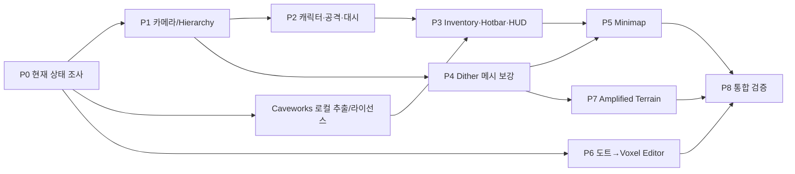

# 02. 실행 순서, 의존성, 작업 단위

## 2.1 전체 Phase와 종속성

Phase 순서는 *권장*이다. P6은 다른 기능과 병렬 진행 가능하지만 같은 파일을 동시에 수정하지 않는다. 각 Phase에서 '완료'에 필요한 코드/테스트/Builder/문서를 모두 다룬다.

## 2.2 Phase별 실행 과제

| Phase | 구현 범위 | 주 수정 예상 파일 | 종료 Gate |
|---|---|---|---|
| P0 | 현행 기능/버전, 원본 조사, Caveworks 설치본 스캔 | 구현 파일 수정 최소 | 조사 보고서, 로컬 증상 재현, 에셋 매니페스트 초안 |
| P1 | 카메라 떨림, Hierarchy | Player View/Input, camera rig, `MultiplayerSliceBuilder` | Host/Client 카메라 안정, Builder 재실행 동일 구조 |
| P2 | 모델, attack, dash | `Assets/Entities/Player/*`, Domain/System, Networking, Builder | owner/remote 애니메이션, 서버 검증된 공격/대시 |
| P3 | 인벤토리, toolbar, HUD | Domain/Networking/ClientState/UI, 에셋, Builder | 슬롯·장비·선택 UI와 실제 state sync, 원본 동등성 |
| P4 | dither 구멍 | `ChunkRenderer`, `ChunkRendererPool`, Rendering, 필요 시 Occlusion | 빈 공간 노출 없음, 렌더만 변하고 collision 불변 |
| P5 | 미니맵 | ClientState/WorldViewBridge/UI + Builder | 월드/플레이어 추적, chunk delta 대응 |
| P6 | Texture→voxel 툴 | `Assets/World/Editor/Tools/`, Fluent IMGUI, EditMode tests | Preview→Apply/Undo/저장/재오픈 |
| P7 | Amplified 지형 | TerrainConfig/Generator/Initialize/Test/옵션 저장 | Normal 호환, seed 결정성, 부하 예산 |
| P8 | 종합 회귀/문서 | 추가 테스트/README/보고 | 테스트 매트릭스/증거 완비 |

## 2.3 공통 단계 — *각* Phase마다 반복

1. 탐색: 관련 코드, 사용 중 Serialized reference, builder/asmdef/asset GUID 조사.
2. 문제/설계: API, owner, readonly vs authoritative, client/server 경계, 복원 정책 문서화.
3. 최소 수직 슬라이스: Model→Command→Replication→Presentation→Input/UX를 실제로 연결.
4. 자동 테스트: Domain unit, Unity EditMode, 필요한 PlayMode/Integration.
5. GUI 및 Build: 씬 생성기 재실행, Prefab/씬 저장, 재실행으로 Missing 확인.
6. 멀티플레이 검증: Host+Client/해당 기능, Dedicated/다중 접속 회귀.
7. 문서/단위 커밋/로그: 변경 의도, 결과 및 알려진 제한을 남김.

## 2.4 트랜잭션처럼 작업하기

- 각 Phase 시작 시 `git status` 스냅샷을 기록.
- 사용자가 이미 수정한 파일을 덮어쓰지 말고 충돌 발생 시 변경 단위를 분리.
- 자동 생성 자산은 builder 재실행/asset import가 결정적이어야 하며 `.meta`가 변경되지 않아야 한다.
- 테스트 결과가 불합격이면 다음 Phase에 합쳐 버리지 말고 원인을 해결한 뒤 진행.
- 신규 DLL/패키지 추가는 원본 기능에 꼭 필요한 최소 범위, `Packages/manifest.json`과 라이선스 기록 필수.
- 기존 인터페이스가 있으면 재사용. 새로운 서비스나 모델을 정의할 때는 기존 DI, 저장, 네트워크 재사용 여부를 먼저 검토.

## 2.5 임의로 결정 가능한 기본값과 검증 조건

- Hotbar 슬롯 개수/키: Caveworks 원본 동작을 우선. 확인이 안 되면 **임시 기본 9칸, 숫자키 1–9/휠**로 구현하되 매니페스트에 임시 결정을 기록.
- Item stacking, split, swap, tooltip: 원본 제공 여부 확인. 최소한 비어 있거나 가득 찬 슬롯·동일/상이한 아이템 이동에서 수량 무결성 필수.
- Dash 조작: Minefarm0 우클릭을 우선 참고하되 MF2 기존 상호작용과 충돌하면 명시적인 입력 매핑을 정하고 게임 UI에 표시.
- HUD: 원본에 있는 체력/퀵슬롯/상태를 우선 구현. 서버 상태가 존재하지 않는 지표는 가짜 숫자로 보여주지 말고 Domain에 실제 지표와 권한 정책을 추가하거나 범위 차이를 보고.
- Minimap: top-down 2D 정적/점진적 갱신 기반으로 먼저 완성.
- Terrain: 기본 `Normal` 프로필은 원본 seed/설정에서 동일한 결과를 유지해야 한다. `Amplified`는 opt-in.

## 2.6 실패/중단 정책

| 상황 | Codex 행동 |
|---|---|
| Caveworks 설치본을 못 찾음 | 발견한 경로/검색 증거 기재, 임의 디컴파일 결과를 만들어내지 않음. 다른 독립 Phase는 진행. |
| AssetRipper 등 미설치 | 공식 배포처, 기존 환경 확인. 무작위 바이너리/관리자 권한 실행 금지. 안전한 다른 경로(UnityPy/Editor 추출) 검토. |
| 에셋 라이선스 불명확 | 공개 레포 재배포 보류, 로컬 사용/대체 가능성 기록. |
| Unity Editor 실행 불가 | 이유/오류 로그 기록, 정적 테스트·모의 실행만 했음을 표기. |
| 데이터 포맷 변경 필요 | 이전 버전 호환/마이그레이션 설계 후 변경. 포맷을 무단 파기하지 않음. |
| 오래 걸리는 작업 | 가능한 Phase를 순차 구현하고 진행/미완료 상태를 명확하게 보고. 테스트 없는 완료 선언 금지. |
